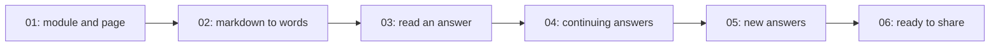

# Tasks: Voice output

## Dependency graph

## Frontier

Tasks whose blockers are all `Status: done`, not yet claimed.

- None: every task is done.

## All tasks

| #   | Title              | Blocked by | Status |
| --- | ------------------ | ---------- | ------ |
| 01  | module-and-page    | None       | done   |
| 02  | markdown-to-words  | 01         | done   |
| 03  | read-an-answer     | 02         | done   |
| 04  | continuing-answers | 03         | done   |
| 05  | new-answers        | 04         | done   |
| 06  | ready-to-share     | 05         | done   |
